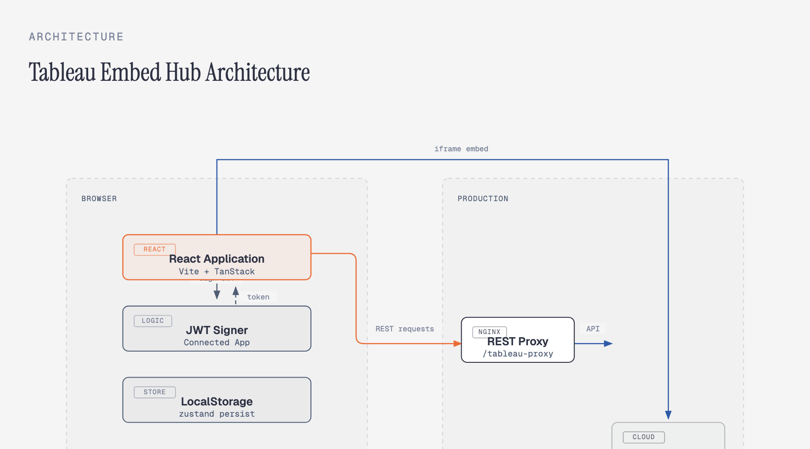
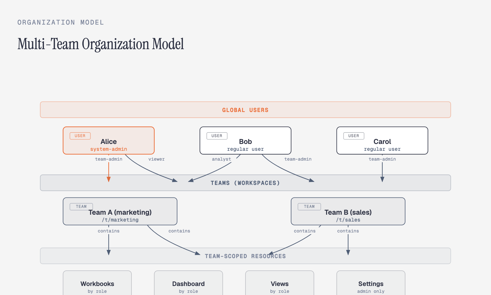
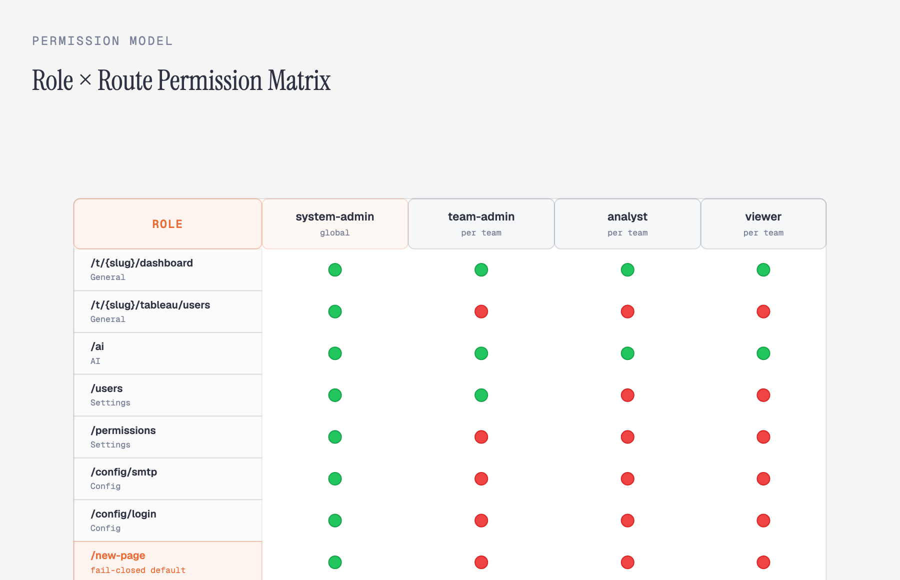
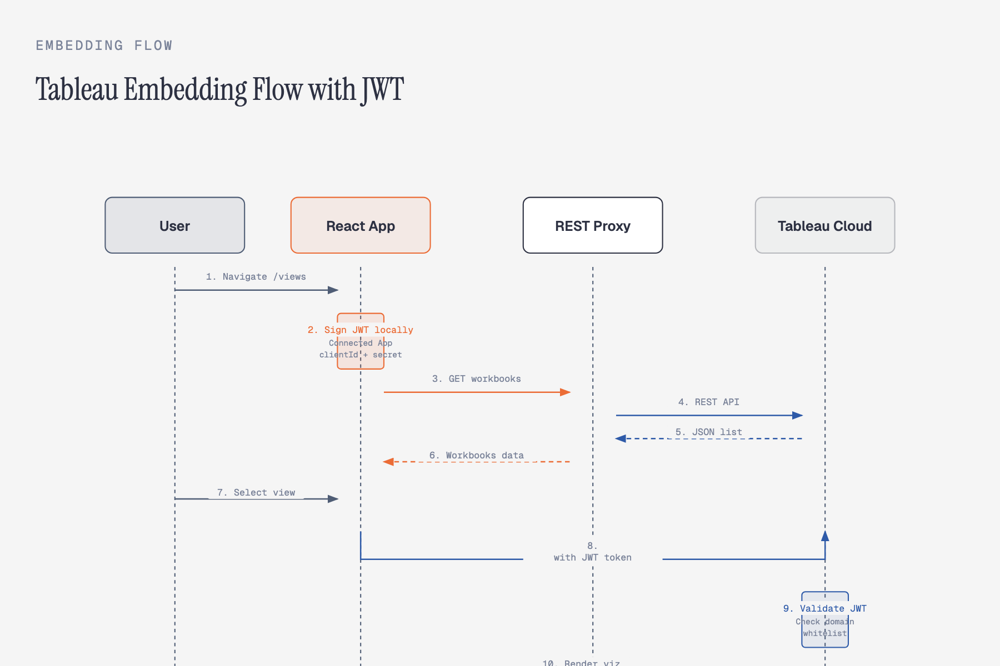
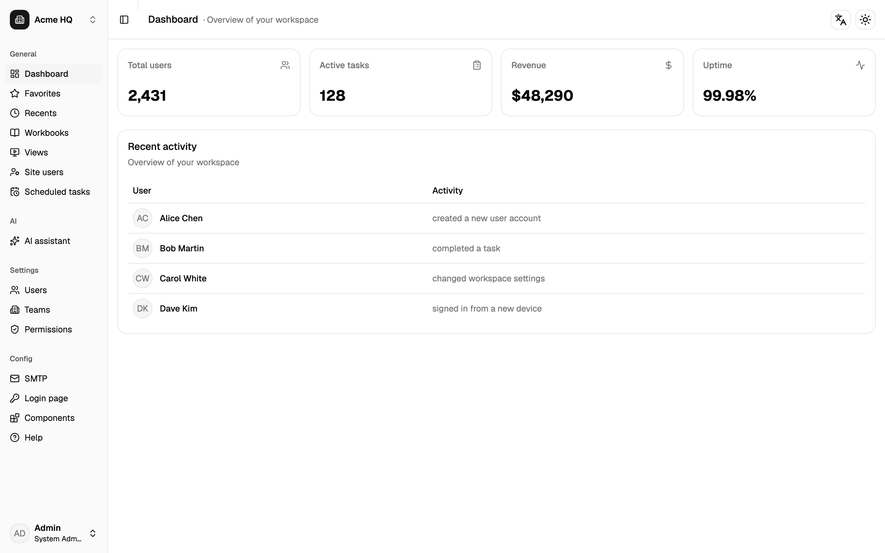
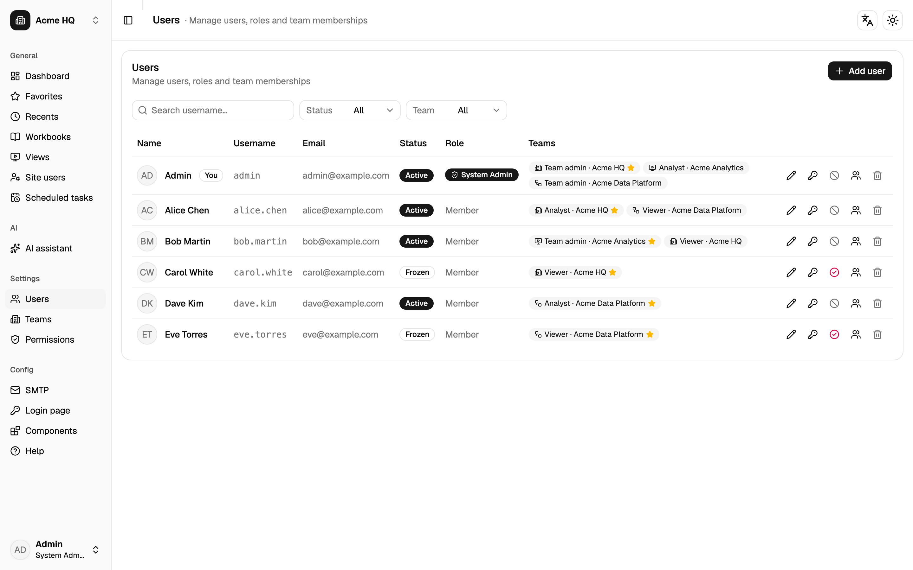
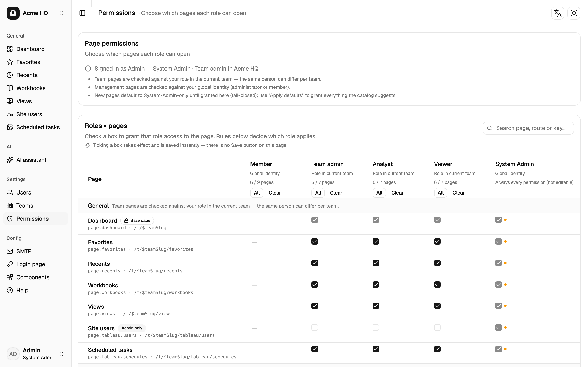
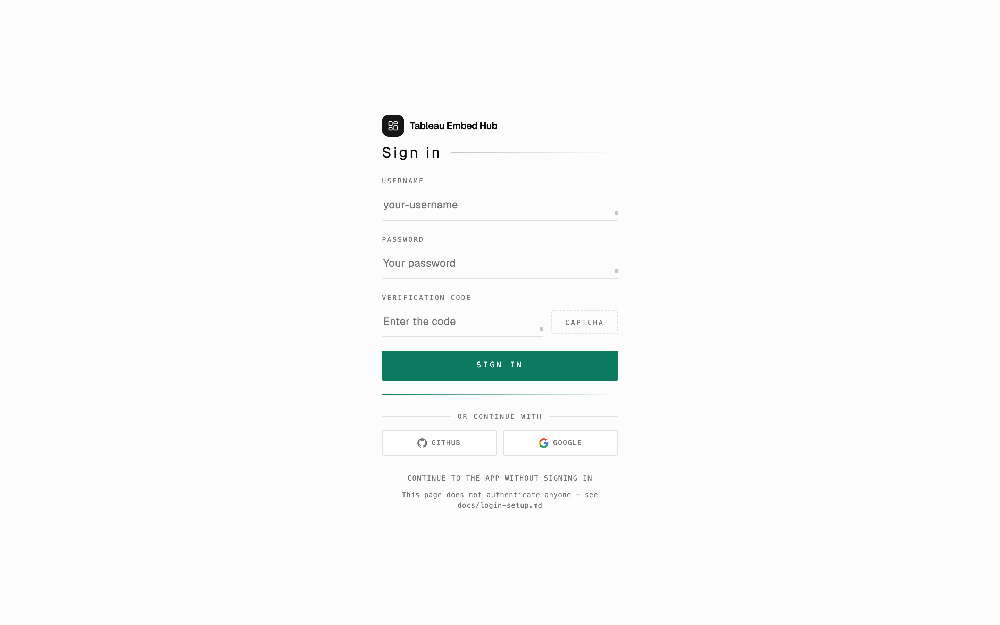

# Tableau Embed Hub

[](https://github.com/tableau-China/Tableau-Embed-Hub/actions/workflows/ci.yml)
[](./LICENSE)
[](./CHANGELOG.md)
[](https://react.dev)
[](https://www.typescriptlang.org)
[](https://tailwindcss.com)
[](https://github.com/tableau-China/Tableau-Embed-Hub/stargazers)
[](./CONTRIBUTING.md)
[](https://nodejs.org)

> English version: [README.en.md](./README.en.md) ｜ 仓库：<https://github.com/tableau-China/Tableau-Embed-Hub>

## 把 Tableau 的分析嵌进你自己的产品，而不是把用户赶去 Tableau

开源的**多团队管理后台 + Tableau 嵌入可视化起点**：团队作用域路由（`/t/{slug}/...`）、页面级权限、
登录页模板、SMTP 配置、AI 对话页、部署样例全部已接线，克隆下来就能改成你自己的东西。
基于 shadcn/ui + Tailwind CSS v4 + Radix UI + TanStack **从零构建** —— 不是别的模板的 fork。

### 核心设计一览

#### 架构：浏览器内 JWT 签发 + 双路径（REST 代理 + iframe 直连）

这套应用采用**纯前端架构**：JWT 签发逻辑完全在浏览器内运行（jose 库），REST API 请求通过 nginx 反向代理转发到 Tableau Cloud，而视图嵌入则是浏览器直连 Tableau 的 iframe。这种设计让部署变得简单（纯静态产物 + nginx 配置），同时保持了 Tableau 嵌入 API 的完整能力。



#### 多租户模型：全局用户 × 团队工作区 × 岗位权限

用户是**全局身份**（跨团队），团队是**工作区边界**（资源隔离），岗位是**团队成员关系上的角色**。同一个人在不同团队可以有不同岗位——比如 Alice 在 Team A 是 admin，在 Team B 只是 viewer。这正是企业内部交付的常态。



#### 权限模型：角色 × 路由矩阵，fail-closed 默认

权限体系是一张**角色 × 路由的勾选矩阵**，在 `/permissions` 页配置。新增页面只需在路由目录登记一行，就自动进入这套体系——侧边栏、路由守卫、权限页三处都读同一份目录。**fail-closed 默认**：未登记的页面一律拦截，避免权限盲区。



#### Tableau 嵌入流程：JWT 签发 → REST 获取元数据 → iframe 嵌入视图

完整的 Tableau 嵌入流程分三步：浏览器内用 jose 库签发 Connected App JWT，通过 REST 代理获取工作簿列表与缩略图（含 `auth/signin` 换取会话令牌），最后用 Tableau Embedding API 把视图嵌入 iframe。令牌与缩略图都纳入 TanStack Query 缓存，减少重复请求。



### 实际效果



**当前状态**：Phase 0–4 已完成 —— 脚手架与 TS 7 工具链、多团队工作区、Tableau 嵌入与站点管理页、
页面级权限、系统配置、AI 起点、部署样例。界面语言当前仅 **en-US**。

> [!WARNING]
> **非官方项目**：与 Salesforce, Inc. 无隶属、授权或赞助关系；Tableau 与 Tableau Cloud 是 Salesforce, Inc. 的商标
> （详见 [THIRD-PARTY.md](./THIRD-PARTY.md)）。软件按「现状」提供，不附带任何担保，也不提供支持承诺 ——
> 使用者需自行遵守 Salesforce 的相关条款。

> [!CAUTION]
> **凭据边界**：纯前端应用，`.env` 与内置演示凭据**都会被内联进构建产物**。
> 部署前请先读 [SECURITY.md](./SECURITY.md)。

## 快速开始

三步，**零配置** —— 什么都不填，也能看到完整界面。

```bash
# 1) 克隆并安装 —— Node.js 24 + pnpm 12.9.1（`packageManager` 已锁定，CI 用同一版本）
git clone https://github.com/tableau-China/Tableau-Embed-Hub.git
cd Tableau-Embed-Hub
pnpm install

# 2) 启动开发服务器 —— 端口固定 5174，只监听 IPv4 环回
pnpm dev            # → http://127.0.0.1:5174
```

**3) 打开 <http://127.0.0.1:5174>，你会看到**

| 你会看到 | 为什么是这样 |
| --- | --- |
| 直接进工作台，**不需要登录** | `/` 自动跳到当前团队的 `/t/acme_hq`（演示数据里是 Admin + 默认团队 Acme HQ） |
| 侧边栏 **General / AI / Settings / Config** 四个分组 | 工作台与 Favorites、Recents、Workbooks、Views 都在 General 下 |
| **真实嵌入的 Tableau 视图** | 不配 `.env` 时走内置**演示站点 + 演示凭据** |
| AI 页能逐字**流式输出** | 走内置**演示 provider**：本地流式输出，不发任何网络请求 |
| 三个演示团队可随时切换 | `acme_hq` / `acme_analytics` / `acme_data_platform`，团队身份就在 URL 里（`/t/{slug}`） |

> 想知道现在用的是演示值还是你自己的值？打开应用内 **`/help` → 环境自检**，它逐项告诉你。

**接下来做什么**

| 我想… | 去哪 |
| --- | --- |
| 接自己的 Tableau Cloud 站点（只改 `.env`，不动代码） | [配置自己的 Tableau 站点](#配置自己的-tableau-站点) ｜ [docs/tableau-setup.md](./docs/tableau-setup.md) |
| 加一个新页面 / 改权限矩阵 | [docs/route-permissions.md](./docs/route-permissions.md) |
| 换登录页样式 / 接真实登录 | [docs/login-setup.md](./docs/login-setup.md) |
| 把 `/ai` 接到真实模型 | [docs/ai-integration.md](./docs/ai-integration.md) |
| 部署到自己的域名 | [deploy/nginx.conf.example](./deploy/nginx.conf.example) |
| 提 PR 前跑通本地校验 | [CONTRIBUTING.md](./CONTRIBUTING.md) |

> ⚠️ **部署前必读**：这是**纯前端**应用，`.env` 里的内容会被内联进构建产物 ——
> 凭据边界、以及仍需你在服务端完成的工作，见 [SECURITY.md](./SECURITY.md)。

## 十秒判断它适不适合你

| 适合 | 不适合 |
| --- | --- |
| 想把 Tableau 视图嵌进**自己产品界面**的团队（而不是让用户都去登录 Tableau） | 想要一个开箱即用的**后端 + 数据库**：这是纯前端模板，数据在浏览器侧（store + localStorage） |
| 需要一个带**权限模型**的管理后台骨架（多团队 / 岗位 / 页面级授权） | 需要现成的**中文界面**：i18n 框架已就绪，但当前只有 en-US 词典 |
| 用 AI 辅助开发做**企业应用交付**，要一份能直接改的起点 | 需要 Tableau 官方客户端的替代品：嵌入依赖 Connected App，能力边界由 Salesforce 决定 |
| 想学一套**从零构建**的 React 19 + TS 7 + Tailwind v4 + TanStack 组合怎么接线 | 想要组件库 / UI 框架本身：这里是应用骨架，组件底层是 shadcn/ui(Radix) |

## 功能页面与入口

| 页面 | 路由 | 入口 | 默认可见角色 |
| --- | --- | --- | --- |
| 工作区（Dashboard / Favorites / Recents / Workbooks / Views） | `/t/{slug}/...` | 侧边栏 General | 团队成员（按岗位） |
| Tableau 站点用户与角色 | `/t/{slug}/tableau/users` | 侧边栏 General | **仅系统管理员**（fail-closed；它写的是站点级角色） |
| Tableau 定时计划运行情况 | `/t/{slug}/tableau/schedules` | 侧边栏 General | 团队成员（按岗位，只读） |
| AI 对话 | `/ai` | 侧边栏 AI | 全体成员（未配代理时走内置演示 provider） |
| 用户 / 团队 / 权限 | `/users`、`/teams`、`/permissions` | 侧边栏 Settings | 成员（权限页仅系统管理员） |
| 个人资料（详情 + 改显示名称 / 登录名 / 口令） | `/profile` | **左下角用户菜单（唯一入口）** | 全体成员（v0.7.0 由 `/settings` 改名；v0.14.3 起四项资料合并为 Your details 单卡，口令只显示状态、永不回显） |
| SMTP 邮件服务 | `/config/smtp` | 侧边栏 Config | 仅系统管理员（fail-closed） |
| 登录页 | `/login` | 直达 / 配置页的「Open preview」 | **无需权限**（登录前页面，裸布局） |
| 登录页配置 | `/config/login` | 侧边栏 Config | 仅系统管理员（fail-closed） |
| 组件总览 | `/components` | 侧边栏 Config | 全体成员（公共件清单 + 实时预览） |
| 帮助 / 关于 | `/help` | **左下角用户菜单（Profile 下面）** | 全体成员（核心功能、开发者、版本号、第三方版权与商标） |

> **Views 的落点**：点侧边栏 **Views**、或直接打开 `/t/{slug}/views`（不带参数）时，先落到**上次打开的视图**；
> 解析不到就用固定兜底视图 `VITE_TABLEAU_FALLBACK_VIEW`（缺省是演示站点上的 `Superstore/Overview`）。
> 带 `?workbook=` / `?view=` 参数的链接仍按参数打开（旧链接行为不变）。

## 核心能力

### 多团队工作区 + 全局用户

用户是全局身份，团队是工作区；同一个人在不同团队可以有不同的**岗位**，权限按「当前团队里的岗位」求值 ——
这正是企业内部交付的常态（同一个分析师，在 A 团队是 admin，在 B 团队是 viewer）。



- 用户必须归属至少一个团队；最后一个系统管理员与当前用户不可删除；默认团队互斥（v0.4.0 / v0.9.0）。
- 团队 slug 创建时手工输入、之后**不随改名而变**（仅英文 / 数字 / 下划线）—— 避免按 slug 做的外部映射静默失配。
- 完整规则见 [docs/org-rules.md](./docs/org-rules.md)。

### 页面级权限（角色 × 路由）

在 `/permissions` 按角色勾选可访问的页面；**新增页面只登记一行**就进入这套体系，侧边栏顺序也由这份目录决定。
路由目录是**唯一数据源**：侧边栏、路由守卫、权限页三处都读它，因此不会出现「加了页面忘了登记」的权限盲区 ——
这一点还有专门的静态校验脚本兜底（`pnpm check:routes`）。



- **fail-closed**：目录里没登记的页面一律拦截，而不是放行。入口不在侧边栏的页面（如 Profile）同样登记在目录里。
- 按钮级权限本版仅预留 `action.*` 命名空间，未实现。
- 详见 [docs/route-permissions.md](./docs/route-permissions.md)。

> ⚠️ 前端权限只控制可见性与直达，**不是安全边界**；接入后端后必须由接口再校验一次。

### Tableau 嵌入

浏览器内签发 Connected App JWT → 嵌入工作簿 / 视图；REST（工作簿列表、缩略图、`auth/signin`）走**同源代理**，
因为 Tableau Cloud REST 不支持 CORS。

- **只改 `.env`，不用改代码**：站点地址 / Site name / 站点内容 URL / 嵌入用户 / Connected App 凭据 / 项目过滤 / API 版本全部可配。
- **应用内自检**：`/help` → 「Environment check」卡片显示当前生效的站点、凭据来源（演示 / `.env`）、项目过滤与代理路径。
- 换站点踩坑、域名白名单、排查表见 [docs/tableau-setup.md](./docs/tableau-setup.md)。

> ⚠️ 构建产物里的凭据是**明文可读**的，混淆只防明文扫描、**不构成加密**。真正的访问控制依赖
> Tableau Cloud 后台的 Connected App 域名白名单、访问级别限制与密钥轮换；如需彻底隐藏密钥，请把 JWT 签发迁移到后端。

### 登录页模板

`/config/login` 选样式（`centered-card` / `split-hero` / `fullscreen-card`）、配宣传图，
并管理 GitHub / Google 第三方入口的**公开参数**；`/login` 按配置渲染，可直达、可预览。
登录框是自研的「纸上语言」样式：mono 小字标签、下划线输入框、聚焦时生长的薄荷强调线、方角主按钮。



> ⚠️ **登录页这一版是 UI 模板**：`/login` **不拦截**任何页面、不创建会话（纯前端伪造登录态是安全剧场）；
> 验证码是占位；**不收集 Client Secret**（前端存 Secret 等于公开）。接后端的完整契约（会话 / 验证码 / OAuth 回调）
> 见 [docs/login-setup.md](./docs/login-setup.md)。

### AI 对话页

`/ai` 是一个能跑的对话页，provider 只在一处可换（`src/lib/ai`）。**零配置时**走内置演示 provider；
把 `VITE_AI_PROXY_URL` 指向一个同源网关（实现 OpenAI 兼容的 `POST /chat/completions` 流式接口 ——
DeepSeek / OpenAI / 多数网关都符合）即可换成真实模型。

> ⚠️ **API Key 绝不进前端**：`.env` 里的值会内联进 bundle，所以页面只发同源代理请求、不带任何 Key。
> 契约、nginx 样例与约 20 行 Node 网关见 [docs/ai-integration.md](./docs/ai-integration.md)。

### 系统配置（SMTP）

`/config/smtp` 提供标准的 SMTP 配置：服务商预设（QQ / 163 / Gmail / 阿里企业邮 / 腾讯企业邮 / Microsoft 365）
一键回填；**7 项实时预检 —— 错误拦保存、提醒放行**；密码留空即保持原密码，重置带二次确认。

> ⚠️ **密码不落盘**：浏览器侧「加密后存 localStorage」的密钥必然随 bundle 一起发出，等于安全剧场 ——
> 因此只持久化非敏感字段，密码仅存内存（刷新需重填）。接入后端后应改为服务端加密存储、接口只回 `hasPassword`。
>
> ⚠️ **预检 ≠ 真实连通性**：浏览器开不了 SMTP 套接字，真实握手（EHLO → STARTTLS → AUTH）必须服务端执行
> （`nodemailer` 的 `transporter.verify()`）。

### 前端通用件与组件总览

新增页面 / 表单请直接用通用件，不要各自发明版面与接线（完整说明见 [docs/ui-conventions.md](./docs/ui-conventions.md)）：

| 通用件 | 作用 |
| --- | --- |
| `PageContainer` | 页面根容器：全站页面宽度一致（**不要在页面级写 `max-w-*`**） |
| `FormGrid` / `FormField` | 表单栅格与字段（label / `aria-invalid` / `aria-describedby` / 说明行一次接好；窄栏加在表单上而非页面上） |
| `useFormTouch` | 校验显示时机：失焦才报该字段、点保存后全报（**主操作不要因校验错误而置灰**） |
| `FilterBar` / `FilterSearch` / `FilterSelect` + `useListFilters` | 列表页筛选栏：搜索 / 下拉 / 结果计数 / 一键重置（**有筛选才出现重置**；空态要区分「没数据」与「被筛掉」） |
| `NoteCallout` | 说明 / 注意事项块（info / warning 两种语气） |
| `DescriptionList` | 「标签 + 值」摘要 |
| `ActionBar` / `ActionButtons` | 操作按钮（主操作恒在最右，窄屏堆叠） |

`/components` 页把这 37 个公共件按 8 个分组列出，每条给出**真实 import 路径 + 一句话用途 + 实时预览**，
清单的唯一来源是 `src/config/component-catalog.ts`（加一个公共件 = 加一行）。

两条被踩过的坑：① 表格的 `TableHead` / `TableCell` 默认 `whitespace-nowrap`，长文案列要显式
`whitespace-normal` 并给列宽，否则表格会顶宽整页（`SidebarInset` / `main` 已有 `min-w-0` 兜底，
过宽内容改为在卡片内部滚动）；② 复合控件（`Select` / `InputGroup`）不落 DOM，`FormField` 传
`injectProps={false}` 并自行把 `id` / `aria-*` 写到真实节点上。

### 校验脚本体系

模板最容易腐烂的地方是「目录与代码各写一份」。所以这里把不变量都写成了可重跑的命令，并进 CI：

```bash
pnpm test           # 130 个纯函数用例：权限语义 / 目录不变量 / SMTP 规则 / 环境变量口径
pnpm check:routes   # 路由文件 ↔ 权限目录一致性（纯静态，阻塞 CI 的步骤）
pnpm check:i18n:keys # 反向漏键：代码里在用的 key 是否都在词典里
pnpm build && pnpm check:permissions   # 页面权限（真实 Chrome CDP 用例）
```

CI 分两个 job：`ci` 跑路径守卫 / i18n / 路由目录 / 单测 / lint / 构建（阻塞）；
`ui-checks` 跑 5 组浏览器用例（`check:team-routes` / `smtp` / `login` / `filters` / `permissions`），
目前仍是 advisory（原因写在 `.github/workflows/ci.yml` 注释里：几何断言依赖字体渲染，Linux 侧尚未实测）。

## 技术栈

| 层 | 选型 | 版本 |
| --- | --- | --- |
| 框架 | React | 19.x |
| 语言 | TypeScript | 7.1.0-beta（原生编译器，beta 通道；lint 另走 TS 6 API 别名，见下） |
| 构建 | Vite | 8.x |
| 样式 | Tailwind CSS v4 + shadcn/ui（radix-nova 预设） | 4.x |
| 组件底层 | Radix UI | 最新 |
| 路由 | TanStack Router（文件路由，路由级代码分割） | 1.x |
| 数据请求 | TanStack Query | 5.x |
| 国际化 | i18next + react-i18next | 26.x（当前仅 en-US，后期扩展） |
| 状态 | zustand（本地持久化） | 5.x |
| 包管理 | pnpm | 12.9.1（`package.json` 的 `packageManager` 锁定，CI 同版本） |
| 运行时 | Node.js | 24（本地与 CI 一致，`@types/node` 对齐 24 线） |

### TypeScript 为什么装了两份

| 包名 | 实际指向 | 谁在用 |
| --- | --- | --- |
| `@typescript/native` | `npm:typescript@7.1.0-beta`（beta 通道） | `tsc` —— `pnpm typecheck` / `pnpm build` |
| `typescript` | `npm:@typescript/typescript6@6.0.2` | `tsc6` —— **只**给 typescript-eslint 解析用 |

typescript-eslint 的 peer 范围仍是 `>=4.8.4 <6.1.0`，**不支持 TS 7**
（上游 [typescript-eslint#10940](https://github.com/typescript-eslint/typescript-eslint/issues/10940) 仍 open）。
不只是声明问题：TS 7 那个包只导出 `./unstable/*` 的新 API，没有 typescript-eslint 需要的经典 JS API
（`createSourceFile` / `createProgram`），所以哪怕放宽 peer 也跑不起来。

**后续计划（两阶段）**

1. **TS 7.1 正式版发布后**：把 `@typescript/native` 换成稳定版 `npm:typescript@7.1.x`，不再跟预发布通道 —— 此时**仍是两份**，只是第一份从 prerelease 换成 stable。
2. **等上游支持 TS 7 后**：**逐步替换掉 TS 6 这条线**，最终只留一份 TypeScript。判据三条，缺一不可：
   ① typescript-eslint 的 peer 上限 ≥ 7；② #10940 已合入并随 stable 发布；③ 实测用同一份 TS 跑
   `pnpm typecheck` + `pnpm lint` 全绿（peer 只是声明，跑得通才算）。

> ⚠️ 在那之前：**升级 TS 7 只动 `@typescript/native`，不要动 `typescript`** —— 后者一动，eslint 立刻挂。

## 配置自己的 Tableau 站点

**只改 `.env`，不用改代码。** 完整步骤（含 Connected App 创建、域名白名单、排查表）见
[docs/tableau-setup.md](./docs/tableau-setup.md)。

```bash
cp .env.example .env      # .env 已被 .gitignore 排除
# 填「站点绑定」三项 + 「凭据」三项，然后重新构建
```

| 你想要 | 改哪里 |
| --- | --- |
| 换站点（地址 / Site name / 站点内容 URL / 嵌入用户） | `.env` 的 `VITE_TABLEAU_SERVER_URL` / `_SITE_NAME` / `_SITE_CONTENT_URL` / `_EMBED_USER` |
| 换 Connected App 凭据 | `.env` 的 `VITE_TABLEAU_CLIENT_ID` / `_SECRET_ID` / `_SECRET_VALUE` |
| 只显示某个项目 / 取消项目过滤 | `.env` 的 `VITE_TABLEAU_PROJECT`（留空 = 不过滤） |
| REST 代理路径（要和生产反代一致） | `.env` 的 `VITE_TABLEAU_API_BASE`（默认 `/tableau-proxy`） |
| REST API 版本 | `.env` 的 `VITE_TABLEAU_API_VERSION`（默认 `3.23`） |
| 品牌名 / 开发者 / 站点链接 | `src/config/app.ts`（唯一来源，测试也读它） |

## 部署

`pnpm build` 产出纯静态资源（`dist/`），可直接丢给任意静态托管；**唯一必须自己配的是 REST 反代**
（Tableau Cloud REST 不支持 CORS）：

1. 把 `dist/` 交给静态托管（CDN / nginx / S3+CDN 均可）；
2. 按 [deploy/nginx.conf.example](./deploy/nginx.conf.example) 把 `/tableau-proxy` 反代到你的站点
   （路径要与 `VITE_TABLEAU_API_BASE` 一致）；
3. 在 Connected App 里把生产域名加进 Trusted Sites。

> 嵌入用的 iframe 直连 Tableau，**不经过**反代；反代只服务 REST（列表、缩略图、`auth/signin`）。
> 前端路由是 history 模式，静态托管需配置「未命中回退到 `index.html`」。

## 脚本

| 命令 | 说明 |
| --- | --- |
| `pnpm dev` | 启动开发服务器（`http://127.0.0.1:5174`，显式固定端口 + IPv4 环回） |
| `pnpm build` | 类型检查（tsc -b）+ 生产构建 |
| `pnpm lint` | ESLint 检查 |
| `pnpm typecheck` | 仅类型检查 |
| `pnpm test` | 纯函数用例（vitest：权限语义 / 目录不变量 / SMTP 规则 / 环境变量口径，毫秒级、不需要浏览器） |
| `pnpm check:i18n` | 校验语言词典 key 对齐（当前仅 en-US） |
| `pnpm check:i18n:keys` | 反向漏键检查：代码里在用的 key 是否都在词典里（`check:i18n` 只比对语言之间的一致性） |
| `pnpm check:routes` | 路由文件 ↔ 权限目录一致性（路由守卫是 fail-open 的，漏登记 = 权限盲区；纯静态、已进 CI） |
| `pnpm check:team-routes` | 团队 slug 路由校验（Chrome CDP，16 用例；需先 `pnpm build`） |
| `pnpm check:permissions` | 页面权限校验（目录静态自检 + 用例；需先 `pnpm build`） |
| `pnpm check:filters` | 列表筛选栏校验（i18n/选项来源静态自检 + 7 项页面用例，含宽窄屏几何断言；需先 `pnpm build`） |
| `pnpm check:smtp` | SMTP 配置校验（规则断言 + 6 项页面用例；需先 `pnpm build`） |
| `pnpm check:login` | 登录页校验（领域层规则断言 + 7 项页面用例：换样式 / provider 开关 / 校验拦截 / 恢复默认；需先 `pnpm build`） |
| `pnpm check:versions` | 依赖版本巡检：对比 registry 的 latest，区分「`pnpm update` 即可」与「需改 package.json」；预发布版（`-dev.` / `-beta.` / `-rc.`）额外比对 `next` 通道；支持 `--md` / `--json` / `--strict` |
| `pnpm check:shadcn-drift` | 组件漂移巡检：`src/components/ui/*` 逐个比对上游 registry，自动过滤本地约定（`cn` 导入路径、无 `"use client"`），只报实质差异（只读，约 2-3 分钟） |
| `node scripts/capture-readme-shots.mjs` | 重新生成本文档的四张截图（需先 `pnpm build`；产物写入 `docs/images/`） |

## 文档地图

| 文档 | 什么时候读 |
| --- | --- |
| [docs/tableau-setup.md](./docs/tableau-setup.md) | 把演示站点换成你自己的 Tableau Cloud 站点 |
| [docs/route-permissions.md](./docs/route-permissions.md) | 加新页面 / 改权限矩阵 / 搞清 `ROUTE_CATALOG` 的语义 |
| [docs/org-rules.md](./docs/org-rules.md) | 改用户、团队、归属、冻结这些组织模型规则 |
| [docs/ui-conventions.md](./docs/ui-conventions.md) | 新增页面 / 表单 / 列表，或想知道为什么不要自己写版面 |
| [docs/ai-integration.md](./docs/ai-integration.md) | 把 `/ai` 从演示 provider 接到真实模型（含网关样例） |
| [docs/login-setup.md](./docs/login-setup.md) | 登录页三套样式、宣传图、第三方入口，以及接后端的契约 |
| [SECURITY.md](./SECURITY.md) | 部署前必读：凭据边界与漏洞上报方式 |
| [THIRD-PARTY.md](./THIRD-PARTY.md) | 第三方组件、商标与版权声明 |
| [CHANGELOG.md](./CHANGELOG.md) | 每个版本改了什么、遗留问题与待办 |
| [PROGRESS.md](./PROGRESS.md) | 进度、关键决策、环境坑与绕法（开发向） |
| [CONTRIBUTING.md](./CONTRIBUTING.md) | 本地开发、提交约定与 PR 流程 |
| [CODE_OF_CONDUCT.md](./CODE_OF_CONDUCT.md) | 参与社区（issue / PR / 讨论）时的行为准则与私密举报渠道 |

## 路线图

- [x] Phase 0：脚手架 + TS 7 工具链验证 + i18n 框架（en-US）+ CI
- [x] Phase 1：布局（侧边栏/头部）+ 工作区页面（Dashboard / Tableau 四页）+ 组织管理（用户 / 团队 / 权限）+ 个人资料 + Config（SMTP）+ 帮助页 + 前端通用件
- [x] Phase 2：列表筛选栏公共件（`/users` 先行）+ 依赖与工具链对齐
- [x] Phase 3：**通用起点**（站点绑定全部 env 化 / 部署样例 / 环境自检 / 英文 README）
- [x] Phase 4：**AI 应用起点**（`src/lib/ai` 抽象 + 流式客户端 + 零配置演示 provider + `/ai` 页面 + 代理契约）
- [ ] Phase 5（可选）：SQLite 后端（Drizzle）+ 双库（SQLite/Postgres）CI 矩阵；JWT 签发下沉到后端
- [ ] 发布 v1：纯前端可运行模板 + 中英双语文档 + 演示站

## 许可

[MIT License](./LICENSE) —— 可商用、可修改、可闭源分发，保留版权与许可声明即可。

> Tableau 与 Tableau Cloud 是 Salesforce, Inc. 的商标；本项目与 Salesforce, Inc. 无隶属、授权或赞助关系。

## 贡献者

感谢每一位提 issue、提 PR、帮忙试用的同学。

<a href="https://github.com/tableau-China/Tableau-Embed-Hub/graphs/contributors">
  
</a>

## Star 趋势

[](https://star-history.com/#tableau-China/Tableau-Embed-Hub&Date)
